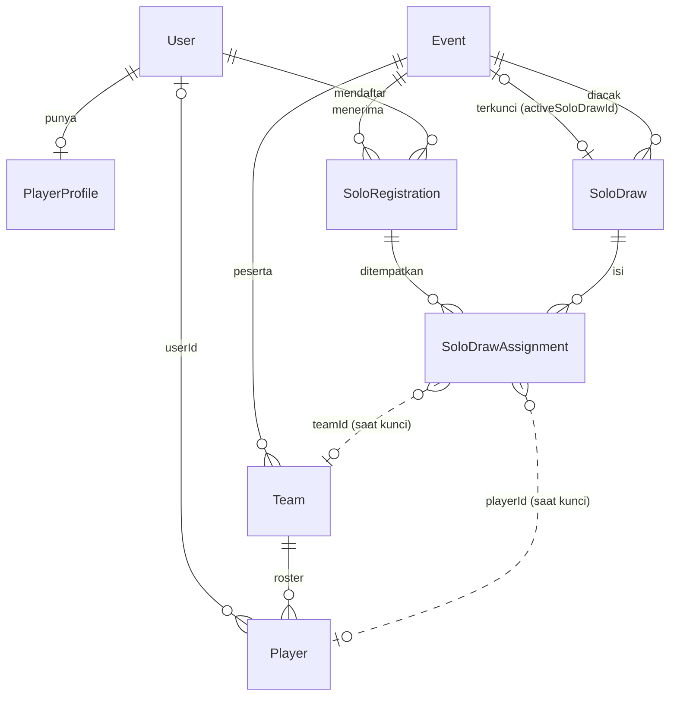

# Desain Database — Turnamen Solo

Status: disetujui pemilik produk untuk fase 1, 12 Oktober 2026. Diimplementasi fase 1 (migrasi `20261013000000_add_solo_tournament`, `20261014000000_solo_assignment_fk_cascade`, `20261015000000_solo_fk_indexes`). Belum diterapkan ke produksi. Stack: Prisma 6 + PostgreSQL (Neon). Aturan migrasi mengikuti `prisma/migrations/` yang ada.

## 1. Prinsip

1. **Tambah, jangan ubah.** Tidak ada kolom yang dihapus atau diubah tipenya. Semua kolom baru nullable atau punya default. Kode lama jalan di database baru.
2. **`Team` dan `Player` tetap pusat.** Pertandingan, grup, bracket, statistik, dan sertifikat memakai `teamId`. Hasil acak yang dikunci **diubah menjadi `Team` + `Player` biasa**. Tidak ada tabel pertandingan baru.
3. **Role tanpa tabel baru.** `User.role` sudah berupa `String` bebas. Nilai baru `player` tidak butuh migrasi, hanya perubahan kode.
4. **Status berupa `String`**, divalidasi di TypeScript, seperti `TeamRegistrationRequest.status`.
5. **Integritas lintas event** memakai kunci asing komposit `(eventId, id)`, pola yang sama dengan `Match` -> `CompetitionPhase`.
6. **Kuota tidak disimpan.** Kuota kiper dan lapangan dihitung dari `Event.participantCap` dan konfigurasi game. Yang disimpan hanya siapa memegang slot (lewat status pendaftaran).

## 2. Gambaran yang ada sekarang (relevan)

| Tabel | Dipakai fitur ini sebagai |
|---|---|
| `User` (`role` String) | Akun pemain: `role = 'player'` |
| `Event` | Penanda event solo + penunjuk hasil acak terkunci |
| `Team` (`source` String) | Hasil kunci: `source = 'solo-draw'`, `captainId` = kapten terpilih |
| `Player` (`displayName` = UID, `nickname` = IGN, `position`) | Hasil kunci: satu baris per pemain |
| `TeamRegistrationRequest` | **Cermin** untuk `SoloRegistration` (status, bukti bayar, alasan tolak, kedaluwarsa). Tidak dipakai langsung, karena tabel itu butuh `teamName` dan `teamTag` dan terikat ke kapten |
| `EventPaymentSettings` | QRIS per event, dipakai apa adanya |
| `CompetitionAuditLog` (`matchId` boleh null) | Jejak audit tutup/acak/kunci/tukar |
| `Notification` | **Tidak dipakai di fase 1.** Tabelnya ada tapi belum dipakai kode mana pun. |
| `RosterChangeRequest` | Ganti pemain sesudah pertandingan dimulai, apa adanya |

## 3. Perubahan pada tabel yang ada

### 3.1 `Event` (2 kolom baru)

```prisma
model Event {
  // ... kolom yang sudah ada ...
  /// "team" (bawaan, semua event lama) | "solo"
  entryMode        String    @default("team")
  /// Hasil acak yang terkunci. Unik, jadi satu event paling banyak satu hasil terkunci.
  activeSoloDrawId String?   @unique
  activeSoloDraw   SoloDraw? @relation("ActiveSoloDraw", fields: [activeSoloDrawId], references: [id], onDelete: SetNull)
  soloRegistrations SoloRegistration[]
  soloDraws         SoloDraw[] @relation("EventSoloDraws")
}
```

Catatan:

- `participantCap` tetap berarti **jumlah tim** dan tetap salah satu dari 8, 12, 16, 24, 32, 64, 128, 256 (daftar itu terkunci di `event-draft.ts`, `publish-readiness.ts`, `event-v3-actions.ts`, `types.ts`, `tournament/engine.ts`). Tidak ada kolom batas pemain: batas pemain = kuota = `participantCap x teamSize`.
- Kuota: slot `required` = `participantCap x jumlah posisi wajib per tim` (Flashpeak: `Goalkeeper` x 1), slot `open` = `participantCap x (teamSize - posisi wajib)`. `requiredPositions` dibaca dari konfigurasi game (kode, bukan tabel). Kuroko 3v3 nanti: `{ Center: 1 }`, isi tim 3, jadi 1 slot `required` + 2 slot `open` per tim. Tidak ada perubahan tabel.
- `format` / `formatConfig` tetap bentuk kompetisi. Cara daftar ada di `entryMode`, bukan di `format`.
- `registrationFeeAmount` / `registrationFeeRequired` untuk event solo berarti **biaya per pemain**.
- Menunjuk hasil terkunci lewat kolom unik (bukan indeks parsial) dipilih karena CI membandingkan `schema.prisma` dengan hasil semua migrasi (`.github/workflows/ci.yml:123-127`), dan Prisma tidak bisa menulis indeks parsial di schema.
- Aturan pemilihan kapten tetap (kapten yang mau dulu, lalu acak), disimpan di `SoloDraw.config` sebagai salinan, bukan kolom event.

### 3.2 `Player` (1 kolom baru)

```prisma
model Player {
  // ... kolom yang sudah ada ...
  /// Akun pemain pemilik baris ini. Null untuk pemain hasil input kapten/impor.
  userId String?
  user   User?   @relation("PlayerUser", fields: [userId], references: [id], onDelete: SetNull)

  @@index([userId])
}
```

Gunanya: riwayat pemain lintas event (fase 3) dan hak akses "pemain melihat timnya". Tidak ada batas unik karena baris `Player` yang diganti (`removedAt`) tetap disimpan.

### 3.3 `User` (hanya relasi, tanpa kolom baru)

```prisma
model User {
  // ... kolom yang sudah ada ...
  playerProfile               PlayerProfile?
  players                     Player[]             @relation("PlayerUser")
  soloRegistrations           SoloRegistration[]   @relation("SoloRegistrationPlayer")
  approvedSoloRegistrations   SoloRegistration[]   @relation("SoloRegistrationApprover")
  createdSoloDraws            SoloDraw[]           @relation("SoloDrawCreator")
  lockedSoloDraws             SoloDraw[]           @relation("SoloDrawLocker")
}
```

## 4. Tabel baru

### 4.1 `PlayerProfile` — data pemain di luar akun

```prisma
model PlayerProfile {
  id        String   @id @default(cuid())
  userId    String   @unique
  user      User     @relation(fields: [userId], references: [id], onDelete: Cascade)
  whatsapp  String
  createdAt DateTime @default(now())
  updatedAt DateTime @updatedAt
}
```

Dipisah dari `User` supaya tabel inti tidak membawa data khusus satu role. `OrganizerProfile` memakai pola yang sama.

### 4.2 `SoloRegistration` — satu pemain mendaftar satu event

Cermin dari `TeamRegistrationRequest`, ditambah antrean.

```prisma
model SoloRegistration {
  id                String    @id @default(cuid())
  eventId           String
  event             Event     @relation(fields: [eventId], references: [id], onDelete: Cascade)
  userId            String
  user              User      @relation("SoloRegistrationPlayer", fields: [userId], references: [id], onDelete: Cascade)

  ign               String
  uid               String
  /// uid dipangkas dan huruf kecil, untuk keunikan tanpa membedakan huruf besar/kecil.
  uidKey            String
  primaryPosition   String
  /// Sama dengan posisi wajib game = pemain darurat (kalau posisi utama bukan posisi wajib). Flashpeak: Goalkeeper. Kuroko: Center.
  secondaryPosition String?
  /// "required" | "open". "required" = posisi utama sama dengan posisi wajib game. Diturunkan dari primaryPosition saat daftar, disimpan supaya hitungan slot murah.
  slotGroup         String
  willingCaptain    Boolean   @default(false)
  /// Salinan saat daftar. Baru terlihat teman satu tim setelah tim dikunci.
  whatsapp          String

  /// queued | pending_payment | pending_review | approved | rejected | expired | withdrawn
  status            String
  proofImageUrl     String?
  rejectReason      String?
  /// Waktu pemain mulai memegang slot (daftar langsung dapat slot, atau naik dari antrean). Null selama queued.
  slotHeldAt        DateTime?
  /// Batas bayar. Null untuk event gratis atau selama queued.
  expiresAt         DateTime?
  approvedAt        DateTime?
  approvedById      String?
  approvedBy        User?     @relation("SoloRegistrationApprover", fields: [approvedById], references: [id], onDelete: SetNull)
  withdrawnAt       DateTime?
  /// Diisi organizer untuk pemain yang sudah bayar lalu batal atau tidak masuk tim.
  refundedAt        DateTime?
  refundNote        String?
  /// Naik tiap perubahan status. Dipakai untuk cek versi (CAS) seperti pembayaran tim.
  version           Int       @default(0)

  assignments       SoloDrawAssignment[]
  createdAt         DateTime  @default(now())
  updatedAt         DateTime  @updatedAt

  @@unique([eventId, userId])
  @@unique([eventId, uidKey])
  @@unique([eventId, id])
  @@index([eventId, slotGroup, status, createdAt])
  @@index([userId])
}
```

Alasan:

- `@@unique([eventId, userId])`: satu akun satu pendaftaran per event.
- `@@unique([eventId, uidKey])`: satu akun game satu pendaftaran per event, tanpa membedakan huruf besar/kecil (sama dengan pengecekan UID roster yang sudah ada). Penahan utama pemain ber-akun ganda.
- `@@unique([eventId, id])`: syarat kunci asing komposit dari `SoloDrawAssignment`.
- `@@index([eventId, slotGroup, status, createdAt])` melayani dua query panas: hitung slot terpakai per kelompok (`status in pending_payment, pending_review, approved`) dan cari pendaftar `queued` tertua untuk naik.
- Antrean diurutkan `createdAt`. Tidak ada kolom urutan terpisah.
- `status` tidak punya nilai bawaan di database: kode menentukan `queued` atau `pending_payment`/`approved` di dalam transaksi, sesuai sisa slot.
- Posisi disimpan sebagai teks, sama dengan `Player.position`. Nilai yang sah berasal dari konfigurasi game (`GameMode.positions`) dan divalidasi di kode.

**Aturan slot** (dijaga di kode, dalam transaksi serializable):

```
terpakai(kelompok) = jumlah pendaftar status in (pending_payment, pending_review, approved)
                     + pendaftar rejected yang expiresAt-nya belum lewat (boleh upload ulang, sama dengan alur tim)
slot ada          = terpakai(kelompok) < kuota(kelompok)
daftar            -> slot ada ? (gratis ? approved : pending_payment) : queued
slot terbuka      -> (withdrawn | expired) -> pendaftar queued tertua di kelompok yang sama
                     naik ke pending_payment, isi slotHeldAt dan expiresAt, kirim email
```

### 4.3 `SoloDraw` — satu kali acak

```prisma
model SoloDraw {
  id               String   @id @default(cuid())
  eventId          String
  event            Event    @relation("EventSoloDraws", fields: [eventId], references: [id], onDelete: Cascade)
  /// 1, 2, 3 ... naik tiap acak ulang.
  version          Int
  /// draft | locked | superseded
  status           String   @default("draft")
  seed             String
  /// Versi aturan pengacakan, supaya hasil lama bisa dijelaskan walau algoritma berubah.
  algorithmVersion String
  /// SHA-256 dari daftar pendaftar approved (id, posisi, kiper darurat, mau kapten) yang diurutkan tetap.
  inputHash        String
  /// Salinan pengaturan saat diacak: isi tim, posisi wajib, aturan kapten.
  config           Json
  teamCount        Int
  /// Pemain approved yang tidak masuk tim (daftar refund).
  unplacedCount    Int      @default(0)
  /// Peringatan yang tampil ke organizer, mis. kiper kurang.
  warnings         Json     @default("[]")

  createdById      String?
  createdBy        User?    @relation("SoloDrawCreator", fields: [createdById], references: [id], onDelete: SetNull)
  lockedById       String?
  lockedBy         User?    @relation("SoloDrawLocker", fields: [lockedById], references: [id], onDelete: SetNull)
  lockedAt         DateTime?

  assignments      SoloDrawAssignment[]
  activeForEvent   Event?   @relation("ActiveSoloDraw")
  createdAt        DateTime @default(now())
  updatedAt        DateTime @updatedAt

  @@unique([eventId, version])
  @@unique([eventId, id])
  @@index([eventId, status])
}
```

Alasan:

- `seed` + `algorithmVersion` + `inputHash` membuat hasil bisa diulang dan diaudit.
- `inputHash` dibandingkan saat kunci. Beda berarti pendaftar berubah sejak diacak dan kunci ditolak.
- Versi lama jadi `superseded`, tidak dihapus.

### 4.4 `SoloDrawAssignment` — siapa masuk mana

```prisma
model SoloDrawAssignment {
  id               String           @id @default(cuid())
  drawId           String
  eventId          String
  draw             SoloDraw         @relation(fields: [eventId, drawId], references: [eventId, id], onDelete: Cascade)
  registrationId   String
  registration     SoloRegistration @relation(fields: [eventId, registrationId], references: [eventId, id], onDelete: Restrict)

  /// Urutan tim 1..T. Null untuk pemain yang tidak masuk tim.
  teamIndex        Int?
  /// starter | unplaced
  role             String
  /// Posisi di tim ini. Posisi wajib game untuk slot wajib (mis. "Goalkeeper"). Kosong untuk unplaced.
  assignedPosition String?
  isCaptain        Boolean          @default(false)

  /// Diisi saat kunci, menunjuk baris yang dibuat. Tanpa kunci asing: Team/Player bisa dihapus tanpa merusak riwayat acak.
  teamId           String?
  playerId         String?
  createdAt        DateTime         @default(now())

  @@unique([drawId, registrationId])
  @@index([drawId, teamIndex])
  @@index([registrationId])
}
```

Penempatan menunjuk draw dan pendaftaran lewat kunci asing komposit `(eventId, ...)`, jadi tidak bisa menunjuk draw atau pendaftaran milik event lain (diuji di database).

Aturan yang dijaga di kode dan diuji (tidak di database, lihat bagian 6):

- Setiap `teamIndex` punya tepat `teamSize` `starter` (Flashpeak 5, Kuroko 3), dan tepat 1 di antaranya memegang posisi wajib (`assignedPosition = 'Goalkeeper'` di Flashpeak, `'Center'` di Kuroko).
- Setiap `teamIndex` punya tepat 1 `isCaptain = true`.
- `unplaced` tidak punya `teamIndex`.

## 5. Diagram hubungan



## 6. Aturan yang tidak bisa ditulis di schema

| Aturan | Dijaga di | Alasan tidak di database |
|---|---|---|
| Slot terpakai tidak melebihi kuota | Transaksi serializable di daftar/naik antrean + tes balapan | Hitungan lintas baris. Kuota tidak disimpan. |
| Tepat 1 kiper utama per tim | Mesin acak + pengecekan akhir sebelum kunci + tes | Butuh indeks parsial. Prisma tidak bisa menuliskannya di schema dan CI akan melihatnya sebagai selisih. |
| Hasil terkunci milik event yang sama | Transaksi kunci + tes | Kunci asing `Event.activeSoloDrawId` tidak membawa `eventId`. |
| Status hanya nilai yang sah | Validasi TypeScript | Pola yang ada: status di `TeamRegistrationRequest` juga `String`. |
| Posisi sah menurut game | `assertPositionAllowed` (sudah ada di `roster-change-rules.ts`) | Daftar posisi ada di konfigurasi kode, bukan tabel. |
| Event solo menolak pendaftaran tim | Pengecekan di `registerTeam` dan pendaftaran dengan pembayaran | Aturan bisnis lintas tabel. |

## 7. Alur data saat kunci

Satu transaksi serializable (pola `runSerializableRegistrationTransaction` yang sudah ada):

1. Panggil `assertEventRosterMutable` (menaikkan `Event.competitionVersion` dan menolak kalau roster sudah terkunci), seperti semua penulis roster yang ada.
2. Baca `SoloDraw` (harus `draft`) dan event (harus `Registration Closed`, `entryMode = 'solo'`, belum ada `activeSoloDrawId`).
3. Hitung ulang `inputHash` dari pendaftar `approved`. Beda dengan `SoloDraw.inputHash` = batal, minta acak ulang.
4. Untuk tiap `teamIndex`: buat `Team`. Beri `createdAt` yang naik berurutan sesuai `teamIndex`, karena jalur bracket lama mengurutkan tim dengan `createdAt` untuk menentukan seed.
5. Untuk tiap penempatan `starter`: buat `Player`. Isi `userId`.
6. Isi `teamId` dan `playerId` di `SoloDrawAssignment`.
7. `SoloDraw.status = 'locked'`, isi `lockedById` dan `lockedAt`. Draf lain milik event itu jadi `superseded`.
8. Isi `Event.activeSoloDrawId`. `participantCap` tidak diubah.
9. Tulis `CompetitionAuditLog` (`action = 'solo_draw_locked'`, payload berisi seed, versi, jumlah tim).

Tanpa langkah `Notification`: fase 1 menampilkan status tim dari data ini di `/player`.

Pemetaan ke tabel yang ada:

| Sumber | Tujuan | Nilai |
|---|---|---|
| (otomatis) | `Team.name` | `Tim {teamIndex}` |
| (otomatis) | `Team.tag` | `T{teamIndex}` (lolos aturan 2-5 huruf/angka kapital) |
| (otomatis) | `Team.logoText` | `T{teamIndex}` |
| (otomatis) | `Team.source` | `solo-draw` |
| `isCaptain` | `Team.captainId` | `SoloRegistration.userId` |
| kapten | `Team.captainName` / `captainIgn` / `captainUid` | nama akun / `ign` / `uid` |
| kapten | `Team.captainContact` | `whatsapp` |
| (otomatis) | `Team.captainIsPlayer` | `true` |
| `SoloRegistration.uid` | `Player.displayName` | UID |
| `SoloRegistration.ign` | `Player.nickname` | IGN |
| `assignedPosition` | `Player.position` | mis. `Goalkeeper` |
| `SoloRegistration.userId` | `Player.userId` | akun pemain |
| event | `Player.eventId` | id event |

`Team` memiliki batas unik `(eventId, name)` dan `(eventId, tag)`. Nama `Tim N` aman karena N unik per event.
`Player` memiliki batas unik `(teamId, nickname)`. Mesin acak mencegah IGN kembar dalam tim.

## 8. Indeks dan pola baca

| Pola baca | Dilayani oleh |
|---|---|
| Daftar pendaftar solo per event, saring status | `SoloRegistration(eventId, slotGroup, status, createdAt)` |
| Hitung slot terpakai per kelompok | indeks yang sama |
| Pendaftar antrean tertua | indeks yang sama (`status = queued`, urut `createdAt`) |
| Pendaftaran milik satu pemain | `SoloRegistration(userId)` |
| Cek UID kembar saat daftar | `SoloRegistration(eventId, uidKey)` unik |
| Muat hasil acak aktif | `Event.activeSoloDrawId` unik, lalu `SoloDrawAssignment(drawId, teamIndex)` |
| Riwayat acak event | `SoloDraw(eventId, status)` |
| Tim pemain di satu event | `Player(userId)` lalu `Team` |

Volume kecil (puluhan sampai ratusan pemain per event), jadi tidak butuh pemartisian atau cache.

## 9. Migrasi

1. **Satu migrasi**: `prisma/migrations/YYYYMMDDHHMMSS_add_solo_tournament/migration.sql`. Nama dan gaya mengikuti `add_roster_change_requests`.
2. **SQL dihasilkan, bukan ditulis tangan**: ubah `schema.prisma`, lalu hasilkan dengan `prisma migrate diff --from-migrations ... --to-schema-datamodel ... --script`. Setelah itu bungkus agar idempotent (`ADD COLUMN IF NOT EXISTS`, `CREATE TABLE IF NOT EXISTS`, blok `DO $$ ... IF NOT EXISTS ...` untuk constraint), seperti migrasi tangan yang sudah ada. Nama constraint harus sama dengan nama bawaan Prisma supaya CI (`migrate diff --exit-code`) tidak melaporkan selisih.
3. **Tanpa backfill.** Semua event lama otomatis `entryMode = 'team'`. Tidak ada baris yang perlu diisi.
4. **Urutan buat**: `PlayerProfile`, `SoloRegistration`, `SoloDraw`, `SoloDrawAssignment`, lalu kolom `Event.*` dan `Player.userId`. Kolom `Event.activeSoloDrawId` dan kunci asingnya dibuat setelah `SoloDraw` ada.
5. **Rollback**: karena tambahan saja, rollback cukup mematikan flag `solo_tournament_v1` dan deploy ulang kode lama. Tabel baru dibiarkan. Tidak ada `DROP`.

### Catatan penerapan di produksi (penting)

Build produksi di Vercel **tidak menjalankan migrasi**, dan sejak PR #69 build produksi **gagal** kalau folder di `prisma/migrations` belum tercatat di `_prisma_migrations` produksi (`scripts/vercel-build.mjs`, `scripts/migration-ledger.mjs`). Urutannya:

1. Gabung PR.
2. Terapkan migrasi ke database produksi **dulu** (Neon SQL Editor atau `pnpm exec prisma migrate deploy` dengan `DIRECT_URL` produksi). Ini langkah manual milik pemilik database.
3. Baru deploy.
4. Flag `solo_tournament_v1` tetap `false` sampai siap.

## 10. Daftar tes untuk database

- Migrasi dari database kosong sampai terbaru lulus, `prisma migrate diff --exit-code` bersih.
- Event lama memuat tanpa error di database baru (nilai bawaan `entryMode = 'team'`).
- Daftar dua kali oleh akun yang sama: ditolak.
- Daftar dua akun dengan UID sama tapi huruf beda (`ABC123` vs `abc123`): yang kedua ditolak.
- Kuota: 32 slot lapangan penuh, pendaftar ke-33 jadi `queued`. Satu `withdrawn` membuat pendaftar `queued` tertua naik.
- Dua pendaftar bersamaan untuk slot terakhir: satu dapat slot, satu `queued`.
- Dua hasil terkunci untuk satu event: yang kedua ditolak (kolom unik).
- Kunci dua kali bersamaan: tepat satu berhasil.
- Hapus event: semua `SoloRegistration`, `SoloDraw`, `SoloDrawAssignment` ikut terhapus.
- Hapus akun pemain: `Player.userId` jadi null, roster tim tetap utuh.
- Hasil acak (uji banyak variasi kiper x kiper darurat x pemain lapangan): tiap tim 5 pemain, 1 kiper, tidak ada pemain ganda, tidak ada IGN kembar dalam tim, hasil sama untuk seed sama, jumlah `unplaced` sesuai hitungan.

## 11. Perubahan kode yang menyertai (ringkasan, rincian di rencana implementasi nanti)

Bukan bagian dokumen database, tapi menentukan cakupan. Daftar dari penelusuran kode:

| Area | File | Perubahan |
|---|---|---|
| Role | `src/lib/platform/types.ts` (`UserRole`), `src/lib/auth/session.ts` (`SESSION_ROLES`), `src/lib/security/authorization.ts`, `src/middleware.ts`, `src/lib/auth/post-login-path.ts` | Tambah `player`. `/captain` terbuka untuk `player` yang kapten tim. Aksi roster/statistik menerima `player` lewat cek kepemilikan tim, aksi "daftar tim" tetap khusus `captain`. |
| Batas jumlah | `event-draft.ts`, `publish-readiness.ts`, `event-v3-actions.ts` | Tidak diubah. Pilihan `participantCap` tetap. |
| Tutup pendaftaran | layar organizer V3 (baru), `src/lib/actions.ts` (`adminUpdateEventStatusAction` sebagai acuan) | Tombol "Tutup pendaftaran". Hari ini hanya form `/admin` lama yang bisa. |
| Mesin turnamen | `src/lib/tournament/operations/commands.ts` | Satu penjaga: tolak `drawing_save` untuk event solo sebelum tim dikunci. Selain itu tidak berubah. |
| Akun | `src/lib/actions.ts` (`captainSignUpAction` jadi acuan `playerSignUpAction`), `src/app/register/*` | Pilihan "Saya pemain". |
| Konfigurasi game | `src/lib/platform/config.ts` (`GameMode`) | Tambah `soloDraw?: { requiredPositions: { Goalkeeper: 1 } }` hanya untuk `mode-flashpeak-5v5` di fase 1. Kuroko menyusul dengan `{ Center: 1 }` (`mode-kuroko-3v3`). |
| Repository | `src/lib/platform/repository.ts` | Daftar solo + slot + antrean, setujui, kunci. Tolak `registerTeam` untuk event solo. |
| Email | `src/lib/email/send.ts` | Satu templat "slot kamu terbuka". |
| Mesin acak | folder baru `src/lib/solo/` | Fungsi murni + tes. |
| Organizer | wizard event, `Registrasi` (`view=draw`) | Pilihan cara daftar, panel kuota dan acak. |
| Pemain | `src/app/[locale]/player/*` | Halaman pemain. |
| Publik | halaman event dan peserta | Tombol "Daftar solo", sisa slot. |
| Teks | `messages/id.json`, `messages/en.json` | Semua teks baru, sesuai Bahasa Lazim. |
| Flag | `src/lib/feature-flags.ts` | `solo_tournament_v1`. |

